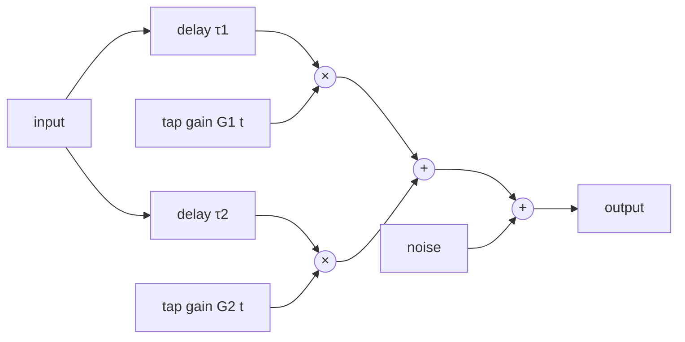

# ionochannel

An HF (shortwave) ionospheric channel simulator for testing receivers,
modems and decoders, and for making training data for neural networks.
It is a Rust crate with a command-line tool, and a numpy Python package
that implements the same model.

Status: 0.1, early. The Watterson fading model, its standard presets and
white noise are done and checked against theory. Receiver effects, noise
and interference are next (see [Roadmap](#roadmap)).

## The model

The Watterson model as ITU-R F.1487 defines it. The signal goes down a
tapped delay line with one tap per propagation path (ionospheric mode).
At each tap the delayed signal is multiplied by a random complex tap
gain, and the taps are summed. Noise is added after that.



A path's tap gain is a sum of components:

- **Rayleigh scatter**: a complex Gaussian process whose Doppler spectrum
  is a Gaussian with a given *spread* (2σ, as F.1487 defines it) and
  *shift*. F.1487 allows two such components per path, for the two
  magneto-ionic modes.
- **Specular**: a steady ray, such as a ground wave, with its own power
  and shift. Added to scatter on the same path, it gives Rice fading.

Two equal paths a delay τ apart fade differently at different
frequencies, with notches every 1/τ. That is the selective fading that
pulls apart AM sidebands, RTTY tones and OFDM carriers.

It works on complex baseband (IQ), or on real audio through the analytic
signal. On audio, a positive Doppler shift moves the audio up; for LSB
audio, flip the sign of the shift.

## Presets

All from the ITU-R texts, checked against them (2026-11-23).
`ionochannel --list` prints them.

| name | delay | spread | source |
|---|---|---|---|
| flat-slow, flat-fast | one path | 0.2, 1 Hz | F.520-2 §2.1 |
| good | 0.5 ms | 0.1 Hz | F.520-2 §2.2.1 = F.1487 mid-latitude quiet |
| moderate | 1 ms | 0.5 Hz | F.520-2 §2.2.2 = F.1487 mid-latitude moderate |
| poor | 2 ms | 1 Hz | F.520-2 §2.2.3 = F.1487 mid-latitude disturbed |
| flutter | 0.5 ms | 10 Hz | F.520-2 §2.2.4 |
| low-quiet / -moderate / -disturbed | 0.5 / 2 / 6 ms | 0.5 / 1.5 / 10 Hz | F.1487 Annex 3 §2 |
| mid-quiet / -moderate / -disturbed | 0.5 / 1 / 2 ms | 0.1 / 0.5 / 1 Hz | F.1487 Annex 3 §3 |
| mid-nvis-disturbed | 7 ms | 1 Hz | F.1487 Annex 3 §3.4 |
| high-quiet / -moderate / -disturbed | 1 / 3 / 7 ms | 0.5 / 10 / 30 Hz | F.1487 Annex 3 §4 |

Each preset has two paths of equal power, except the flat ones, which
have one. The presets live in
[`python/ionochannel/presets.json`](python/ionochannel/presets.json),
which both implementations read.

## Command line

```sh
cargo install --path .
ionochannel --preset poor --snr 6 in.wav out.wav             # audio
ionochannel --preset high-disturbed --snr 0 iq.wav out.wav   # 2-channel WAV = I/Q
ionochannel --rate 24000 --preset flutter in.cf32 out.cf32   # complex float32
ionochannel --path 0,1,0,0.4 --path 2.5,1,0.5,0.3 --specular 0,0.3 in.wav out.wav
```

- **SNR:** measured against the input's mean power, in a reference
  bandwidth (`--bw`, 2500 Hz by default). The noise is added after the
  fading, so it's the SNR before fading.
- **Alignment:** the output lines up with the input. The filters'
  latency is taken out.
- **Reproducibility:** `--seed` fixes the realisation, and the crate's
  own random generator keeps it the same on every platform and in every
  version.

## Rust

```rust
use ionochannel::{presets, Channel};
use num_complex::Complex32;

let mut ch = Channel::new(12000.0, &presets::get("poor").unwrap().paths, 1);
let mut block = vec![Complex32::new(1.0, 0.0); 1024];
ch.process(&mut block); // streams: any block size, no end, same output
```

`RealChannel` does the same for real audio. `noise` adds white noise at
an SNR in a bandwidth.

## Python

```python
import numpy as np, ionochannel as ic

rng = np.random.default_rng(1)
ch = ic.Channel(12000, ic.preset("poor"))
y = ch.apply(x, rng)          # x: (..., n) real or complex; each row its own fading
y = ic.awgn(y, snr_db=rng.uniform(-10, 20, len(x)), fs=12000, rng=rng,
            signal_power=ic.power(x))
```

- **Dependencies:** numpy only. Install with `pip install .`, or put
  `python/` on the path.
- **How it differs from the Rust crate:** it works on whole arrays, with
  fractional delays done in the frequency domain, so there's no latency.
  Each leading index, such as a batch row, gets its own fading.
- **Speed:** a batch of 128 × 4 s at 12 kS/s takes about 2 s on one CPU
  core, about 250× real time. The FFTs dominate.
- **Seeds:** the same seed gives different numbers from the Rust crate,
  but the same statistics.

## Validation

Both implementations are tested against closed-form theory
([`tests/stats.rs`](tests/stats.rs),
[`python/tests/test_stats.py`](python/tests/test_stats.py)):

- **Fade depths:** Rayleigh, P(power < x·mean) = 1 − e^(−x).
- **Doppler spread and spectrum shape:** two lags of the autocorrelation
  against exp(−2π²σ²τ²).
- **Doppler shift:** from the autocorrelation's phase.
- **Level-crossing rate:** √(4π)·σ·ρ·e^(−ρ²).
- **Average fade duration:** (1 − e^(−ρ²)) / N.
- **Two-path frequency correlation:** |cos(πΔfτ)|.
- **Paths independent of each other.**
- **Fractional delays:** exact for tones up to 0.375 fs.
- **Streaming:** the output doesn't depend on block size.

[`tools/compare_skywave.py`](tools/compare_skywave.py) checks both
against [skywave](https://github.com/openarq-project/skywave)'s Watterson
channel. The results are in [docs/validation.md](docs/validation.md).

```sh
cargo test --release
python3 python/tests/test_stats.py      # or pytest
```

## Roadmap

Ordered by what the first users need: training data for neural noise
reduction (SSB voice, CW, AM broadcast) and for a signal identifier, and
synthetic tests for CW and FSK decoders. Background for each item is in
[docs/references.md](docs/references.md).

1. **Receiver effects:** SSB passband (300–2700 Hz), mistuning (about
   ±150 Hz), AGC, clock offset.
2. **Impulsive atmospheric noise** (Hall or Middleton Class A),
   calibrated to ITU-R P.372 (Vd, APD), with the man-made noise floor
   set by site type; **man-made interference:** switching-supply combs,
   powerline harmonics, VDSL, powerline OFDM bursts, LED drivers.
3. **Interfering stations:** CW and data traffic per band, after
   Mendieta-Otero et al. 2014; carriers, adjacent AM stations, sweeping
   radars.
4. **Recorded noise:** mix in real HF noise recordings from files at a
   given level.
5. **A PyTorch backend** with the same API as the numpy functions, to
   make training data on the GPU.
6. **Conditions that change over time:** each path's delay, shift,
   spread and power drift slowly, or are replayed from measured Doppler
   records (HamSCI Grape: WWV/CHU). That covers travelling ionospheric
   disturbances, dawn and dusk, and paths that come and go.
7. **More presets:** auroral substorm (DAMSON: spread 2–55 Hz, delay up
   to 11 ms), polar cap, equatorial spread-F, and NVIS with ground wave,
   sporadic E and F2 as separate paths.
8. **A wideband mode** (Vogler & Hoffmeyer) for signals wider than about
   12 kHz.
9. **Absorption events:** a sudden ionospheric disturbance fade-out and
   polar cap absorption.

## Licence

MIT. See [LICENSE](LICENSE).
