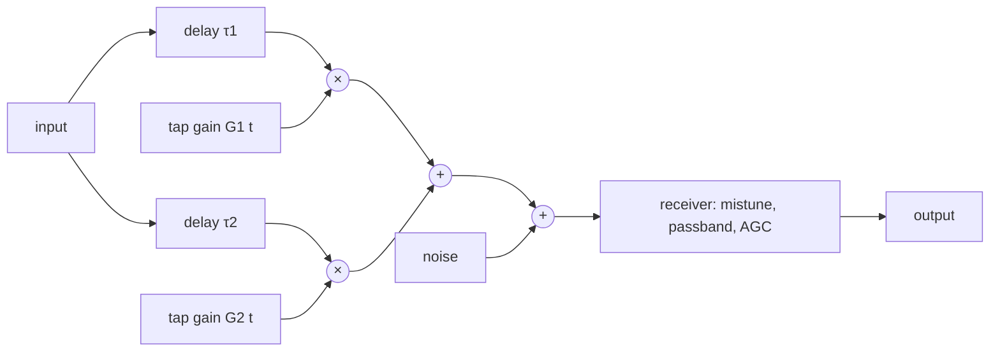

# ionochannel

An HF (shortwave) ionospheric channel simulator for testing receivers,
modems and decoders, and for making training data for neural networks.
It is a Rust crate with a command-line tool, and a numpy Python package
that implements the same model.

Status: 0.1, early. The Watterson fading model, its standard presets,
white noise, impulsive atmospheric noise (QRN), man-made interference
(switching-supply combs, powerline arcing), interfering stations (CW,
AM, carriers, radar) and the receiver (mistuning, passband, AGC) are done
and checked against theory, ITU-R P.372 or their own parameters. Mixing
in recorded noise is next (see [Roadmap](#roadmap)).

## The model

The Watterson model as ITU-R F.1487 defines it. The signal goes down a
tapped delay line with one tap per propagation path (ionospheric mode).
At each tap the delayed signal is multiplied by a random complex tap
gain, and the taps are summed. Noise is added after that, and then the
receiver mistunes, filters and applies AGC.



A path's tap gain is a sum of components:

- **Rayleigh scatter**: a complex Gaussian process whose Doppler spectrum
  is a Gaussian with a given *spread* (2σ, as F.1487 defines it) and
  *shift*. F.1487 allows two such components per path, for the two
  magneto-ionic modes.
- **Specular**: a steady ray, such as a ground wave, with its own power
  and shift. Added to scatter on the same path, it gives Rice fading.

Two equal paths a delay τ apart fade differently at different
frequencies, with notches every 1/τ. That is the selective fading that
pulls apart AM sidebands, RTTY tones and OFDM carriers.

It works on complex baseband (IQ), or on real audio through the analytic
signal. On audio, a positive Doppler shift moves the audio up; for LSB
audio, flip the sign of the shift.

## Atmospheric noise (QRN)

Lightning makes noise that comes in bursts: crackles and crashes rather
than a steady hiss. ITU-R P.372 measures how bursty it is with the
voltage deviation, Vd = 20 log10(rms / mean) of the envelope in a 200 Hz
bandwidth. Gaussian noise has 1.05 dB. P.372-18 Fig. 37 gives the
amplitude distribution for each Vd, and Fig. 38 how Vd grows with
bandwidth.

- **The model:** Gaussian noise whose power follows a train of bursts
  (sferics):
  - The bursts arrive at random (Poisson).
  - Each has an energy from a Pareto law, P(a² > x) = x^−2.
  - Each decays exponentially, with a time constant between 0.1 and
    100 ms (log-uniform).
  - A Gaussian floor carries a share of the power that falls with Vd
    (10 % at Vd 2 dB, 0.05 % at 14 dB).
- **Vd sets everything:** you give Vd in 200 Hz (1.05 to 14 dB), and
  the burst rate comes from a table calibrated by simulation, in
  [`qrn.json`](python/ionochannel/qrn.json). It runs from 86 bursts/s
  at Vd 2 dB to 0.7 bursts/s at 14 dB.
- **Level:** set like white noise: the noise's mean power against the
  signal, in a reference bandwidth. A short clip at a high Vd can be well
  above or below that mean, since a few bursts carry most of the power.
- **How well it matches P.372-18**, checked with
  [`tools/check_qrn.py`](tools/check_qrn.py) on a seed the calibration
  didn't use:
  - Vd in 200 Hz is within 0.25 dB of the target.
  - Fig. 38: Vd in 2 and 6 kHz is within 1 dB of the figure, and in
    20 Hz within 2 dB.
  - Fig. 37: the amplitude distribution is within 2.5 dB at Vd 2–10,
    0.9 dB on average.
  - These compare with values digitised from the figures, which are
    raster images.
- **The 200 Hz filter is an ideal rectangle.** Vd depends on the
  filter's shape: through a 4-pole Butterworth with the same noise
  bandwidth, the same noise reads 0.5 dB higher at Vd 3, 1.7 dB at 8 and
  2.8 dB at 12. P.372 doesn't say which filter its 200 Hz values assume.
- **Choosing Vd:** P.372-18 no longer gives Vd values; see
  [docs/references.md](docs/references.md). For the Vd in another
  bandwidth, `vd_bandwidth` (Python) and `qrn::vd_bandwidth` (Rust)
  apply Fig. 38. For example, Vd 8 dB in 200 Hz is about 10.4 dB in
  2.4 kHz.

## Man-made interference

P.372 §6 sorts man-made noise into wideband, impulsive, and "single
carrier noise" from nearby sources, but gives no parameters for the last
two. The defaults below are illustrative, not measured; set your own.

- **Switching-supply comb** (`smps`, `Smps`): a supply's harmonics,
  lines `spacing` apart (its switching frequency, 60 kHz by default),
  one of them at `offset` in the band. So in a 3 kHz window it is
  usually one line, and in wide IQ a comb.
  - The lines wander together: a random drift, 20 Hz rms with a 10 s
    correlation time by default.
  - They carry AM (depth 0.3) and FM (±15 Hz) at twice the mains
    frequency, from the rectifier ripple.
  - Level: each line's power against the signal, in dB.
- **Powerline arcing** (`arcing`, `Arcing`): short noise bursts at a
  fixed phase of each mains half-cycle, one phase per source, so 100 or
  120 bursts per second per source.
  - Default bursts: 0.1 ms long, ±0.2 ms of timing jitter, energies
    log-normal with a 4 dB spread.
  - It can switch on and off at random (`on_s`, `off_s`).
  - Level: mean power as an SNR in a reference bandwidth, like white
    noise.

## Interfering stations

Each station sits at an offset in the band, at a level in dB against the
signal's power, and can fade on its own (flat Rayleigh fading with a
Doppler spread `fade_hz`). On real audio only the positive frequencies
are kept, so a station near 0 Hz loses its lower half rather than
folding it back. The defaults are illustrative.

- **CW** (`cw`, `Cw`): Morse with standard timing: a dit is 1.2/WPM s,
  a dah 3 dits, and the gaps are 1 dit inside a character, 3 between
  characters and 7 between words. The text is random groups of 2–6
  characters, or yours, repeated. Keying edges are raised-cosine, 5 ms
  by default. Level: key-down power.
- **AM** (`am`, `Am`): a carrier modulated by your audio, or by
  speech-like noise (white noise tilted by one-pole filters at 200 and
  500 Hz, times a slow 3 Hz envelope).
  - The audio is scaled to 0.3 rms and clipped at ±1, like a broadcast
    limiter. It modulates at `depth` (1 by default), and the sidebands
    are limited to ±4.5 kHz.
  - Level: carrier power.
  - Run the whole AM signal as IQ through the channel and you get
    selective fading across its 9 kHz.
- **Carrier:** use `smps`/`--carrier` with no ripple and one line.
- **Radar** (`radar`, `Radar`): FMCW, linear up-sweeps of `sweep_hz`
  (20 kHz) centred on the offset, `rate_hz` (50) a second. A sweep
  crosses a 6 kHz band in 6 ms, so in a receiver it's a fast repeating
  swish. It is tapered off at the band edges, so it doesn't alias. Level:
  power while in the band.

There is no statistical population of stations per band, time and place
yet (Mendieta-Otero et al. 2014); choose the stations yourself.

## Receiver

After the channel and the noise, in this order:

- **Mistuning:** shifts everything by a frequency; positive moves the
  audio up. In Python it can be one value per batch row.
- **Passband:** a linear-phase FIR with −6 dB points at the given edges,
  a 60 dB stopband and a transition width (100 Hz by default) between
  pass and stop edges. The length follows from Kaiser's formula: 437
  taps at 12 kS/s and 100 Hz. The taps are complex, so on IQ the band can
  be one-sided: 300 to 2700 Hz is USB, −2700 to −300 Hz is LSB.
- **AGC:** a peak AGC working in 1 ms blocks. Each block's peak envelope
  updates a level: up with the attack time constant; held for the hang
  time after the last peak within 1 dB of the level; then down
  exponentially with the decay time constant. The gain is the output
  target over the level, at most the maximum gain, ramped across each
  block. Defaults: attack 2 ms, no hang, decay 0.5 s, output peak 0.25,
  at most 60 dB. A rise in level overshoots for about the attack time,
  as in a receiver. The AGC starts settled on the first block's level.

On real audio the receiver works on the analytic signal, and the AGC
follows its envelope. The Rust and Python receivers give the same output
for the same input, to about 1e-6.

## Presets

All from the ITU-R texts, checked against them (2026-11-23).
`ionochannel --list` prints them.

| name | delay | spread | source |
|---|---|---|---|
| flat-slow, flat-fast | one path | 0.2, 1 Hz | F.520-2 §2.1 |
| good | 0.5 ms | 0.1 Hz | F.520-2 §2.2.1 = F.1487 mid-latitude quiet |
| moderate | 1 ms | 0.5 Hz | F.520-2 §2.2.2 = F.1487 mid-latitude moderate |
| poor | 2 ms | 1 Hz | F.520-2 §2.2.3 = F.1487 mid-latitude disturbed |
| flutter | 0.5 ms | 10 Hz | F.520-2 §2.2.4 |
| low-quiet / -moderate / -disturbed | 0.5 / 2 / 6 ms | 0.5 / 1.5 / 10 Hz | F.1487 Annex 3 §2 |
| mid-quiet / -moderate / -disturbed | 0.5 / 1 / 2 ms | 0.1 / 0.5 / 1 Hz | F.1487 Annex 3 §3 |
| mid-nvis-disturbed | 7 ms | 1 Hz | F.1487 Annex 3 §3.4 |
| high-quiet / -moderate / -disturbed | 1 / 3 / 7 ms | 0.5 / 10 / 30 Hz | F.1487 Annex 3 §4 |

Each preset has two paths of equal power, except the flat ones, which
have one. The presets live in
[`python/ionochannel/presets.json`](python/ionochannel/presets.json),
which both implementations read.

## Command line

```sh
cargo install --path .
ionochannel --preset poor --snr 6 in.wav out.wav             # audio
ionochannel --preset high-disturbed --snr 0 iq.wav out.wav   # 2-channel WAV = I/Q
ionochannel --rate 24000 --preset flutter in.cf32 out.cf32   # complex float32
ionochannel --path 0,1,0,0.4 --path 2.5,1,0.5,0.3 --specular 0,0.3 in.wav out.wav
ionochannel --preset poor --snr 3 --ssb --mistune 80 in.wav out.wav   # SSB receiver
ionochannel --preset moderate --snr 10 --qrn 6,8 --ssb in.wav out.wav   # plus QRN, Vd 8 dB
ionochannel --preset poor --snr 15 --smps -20,1700 --arcing 5 --mains 60 --ssb in.wav out.wav
ionochannel --preset good --snr 20 --cw -3,1200,25 --cw -10,600 --carrier -20,2200 --radar -6,1500 --ssb in.wav out.wav
ionochannel --preset moderate --passband -4500,4500 --agc 2000,1000 am-iq.wav out.wav  # AM as I/Q
```

- **QRN:** `--qrn DB,VD` adds atmospheric noise at an SNR in `--bw`,
  with Vd in dB (200 Hz). It adds to `--snr`'s white noise if both are
  given.
- **Man-made:** `--smps DB,F[,SPACING]` adds a switching-supply comb with
  a line at F Hz, each line DB against the signal. `--arcing DB` adds
  arcing buzz at an SNR in `--bw`. `--mains HZ` sets 50 or 60 Hz for
  both.
- **Stations** (each can be repeated): `--cw DB,F[,WPM]`, `--am DB,F`,
  `--carrier DB,F`, `--radar DB,F[,SWEEP_HZ,RATE_HZ]`. The stations don't
  go through the channel; each is added after it, at its own level.
- **Receiver:** `--mistune HZ`, `--passband LO,HI`, `--transition HZ`,
  `--agc DECAY_MS[,HANG_MS[,ATTACK_MS]]`. `--ssb` is
  `--passband 300,2700 --agc 500`.

- **SNR:** measured against the input's mean power, in a reference
  bandwidth (`--bw`, 2500 Hz by default). The noise is added after the
  fading, so it's the SNR before fading.
- **Alignment:** the output lines up with the input. The filters'
  latency is taken out.
- **Reproducibility:** `--seed` fixes the realisation, and the crate's
  own random generator keeps it the same on every platform and in every
  version.

## Rust

```rust
use ionochannel::{presets, Channel};
use num_complex::Complex32;

let mut ch = Channel::new(12000.0, &presets::get("poor").unwrap().paths, 1);
let mut block = vec![Complex32::new(1.0, 0.0); 1024];
ch.process(&mut block); // streams: any block size, no end, same output
```

`RealChannel` does the same for real audio. `noise` adds white noise at
an SNR in a bandwidth; `Qrn::new(fs, vd_db, seed)` adds QRN the same way
(`add_c`, `add_r`), and so do `Smps::new(fs, offset_hz, &SmpsSpec, real,
seed)` and `Arcing::new(fs, &ArcingSpec, seed)`. The stations are
`Cw::new(fs, offset_hz, &CwSpec, real, seed)`, `Am::new` (or
`Am::with_audio`) and `Radar::new`. `Receiver` and `RealReceiver` stream the same
way, with `ReceiverSpec::ssb()` or your own `ReceiverSpec { mistune_hz,
passband, transition_hz, agc }`; `latency()` says how far the output
lags.

## Python

```python
import numpy as np, ionochannel as ic

rng = np.random.default_rng(1)
ch = ic.Channel(12000, ic.preset("poor"))
y = ch.apply(x, rng)          # x: (..., n) real or complex; each row its own fading
y = ic.awgn(y, snr_db=rng.uniform(-10, 20, len(x)), fs=12000, rng=rng,
            signal_power=ic.power(x))
y = ic.qrn(y, snr_db=10, vd_db=8, fs=12000, rng=rng, signal_power=ic.power(x))
y = ic.smps(y, level_db=-20, offset_hz=rng.uniform(300, 2700), fs=12000, rng=rng,
            spec=ic.Smps(mains_hz=50), signal_power=ic.power(x))
y = ic.arcing(y, snr_db=5, fs=12000, rng=rng, spec=ic.Arcing(off_s=3.0),
              signal_power=ic.power(x))
y = ic.cw(y, level_db=-6, offset_hz=rng.uniform(300, 2700, len(x)), fs=12000, rng=rng,
          spec=ic.Cw(wpm=25, fade_hz=1.0), signal_power=ic.power(x))
y = ic.Receiver.ssb(12000, mistune_hz=rng.uniform(-150, 150, len(x))).apply(y)
# or ic.Receiver(fs, passband=(lo, hi), mistune_hz=..., agc=ic.Agc(decay_s=2.0))
```

- **Dependencies:** numpy only. Install with `pip install .`, or put
  `python/` on the path.
- **How it differs from the Rust crate:** it works on whole arrays, with
  fractional delays done in the frequency domain, so there's no latency.
  Each leading index, such as a batch row, gets its own fading.
- **Speed:** a batch of 128 × 4 s at 12 kS/s takes about 2 s on one CPU
  core, about 250× real time. The FFTs dominate. The SSB receiver adds
  about 1.3 s, QRN 1.1 s (Vd 8) to 1.7 s (Vd 2), a switching-supply
  comb 0.9 s and arcing 0.3 s. A CW station takes 0.8 s (1.0 s fading),
  an AM station 1.2 s and a radar 0.6 s.
- **Seeds:** the same seed gives different numbers from the Rust crate,
  but the same statistics.

## Validation

Both implementations are tested against closed-form theory
([`tests/stats.rs`](tests/stats.rs),
[`python/tests/test_stats.py`](python/tests/test_stats.py)):

- **Fade depths:** Rayleigh, P(power < x·mean) = 1 − e^(−x).
- **Doppler spread and spectrum shape:** two lags of the autocorrelation
  against exp(−2π²σ²τ²).
- **Doppler shift:** from the autocorrelation's phase.
- **Level-crossing rate:** √(4π)·σ·ρ·e^(−ρ²).
- **Average fade duration:** (1 − e^(−ρ²)) / N.
- **Two-path frequency correlation:** |cos(πΔfτ)|.
- **Paths independent of each other.**
- **Fractional delays:** exact for tones up to 0.375 fs.
- **Streaming:** the output doesn't depend on block size.

Man-made interference is tested against its own parameters
([`tests/interference.rs`](tests/interference.rs),
[`python/tests/test_interference.py`](python/tests/test_interference.py)):

- **Comb:** lines at the right frequencies and powers, nothing between
  them; AM sidebands at m/2; FM deviation within 0.5 Hz; drift rms within
  10 %.
- **Arcing:** mean power within 10 %; over 90 % of the energy within
  ±1 ms of one phase of the half-cycle; on time within 5 % of
  on / (on + off).

Stations are tested against their parameters
([`tests/stations.rs`](tests/stations.rs),
[`python/tests/test_stations.py`](python/tests/test_stations.py)):

- **CW:** "PARIS" is 50 units with 22 key-down; duty 0.44 ± 0.01; it
  repeats every 3 s at 20 WPM; 10–90 % rise 0.59 × the rise time.
- **AM:** carrier within 1 %; a tone modulates at 0.3 rms; nothing
  beyond the audio bandwidth; on real audio the lower sideband below
  0 Hz is dropped, not folded.
- **Radar:** sweep rate within 1 %; in-band time as expected.

The receiver is tested against its design
([`tests/receiver.rs`](tests/receiver.rs),
[`python/tests/test_receiver.py`](python/tests/test_receiver.py)):

- **Passband:** 0 ± 0.02 dB in the band, −6.02 ± 0.1 dB at the edges,
  below −59 dB at the stop edges and beyond.
- **Mistuning:** a 1000 Hz tone comes out at 1150 Hz, with nothing left
  at 1000 or 850 Hz.
- **Latency:** the Rust output equals the input delayed by `latency()`.
  Python has none.
- **AGC:** holds the target to 0.01 dB; after a 20 dB rise it is within
  1 dB in 6 ms; after a 20 dB drop it is back to −1 dB after
  decay × ln(10 / 10^(1/20)), give or take 3 ms, plus the hang time if
  set; below the floor the gain is the maximum gain.

QRN is tested against its calibration ([`tests/qrn.rs`](tests/qrn.rs),
[`python/tests/test_noise.py`](python/tests/test_noise.py)): Vd in 200 Hz
within 0.5 dB of the target, Vd in 2 kHz within 1 dB of Fig. 38, mean
power within 10 %, Vd 1.05 dB gives Gaussian noise, and streaming
doesn't depend on block size.

Man-made interference is tested against its own parameters
([`tests/interference.rs`](tests/interference.rs),
[`python/tests/test_interference.py`](python/tests/test_interference.py)):

- **Comb:** lines at the right frequencies and powers, nothing between
  them; AM sidebands at m/2; FM deviation within 0.5 Hz; drift rms within
  10 %.
- **Arcing:** mean power within 10 %; over 90 % of the energy within
  ±1 ms of one phase of the half-cycle; on time within 5 % of
  on / (on + off).

Stations are tested against their parameters
([`tests/stations.rs`](tests/stations.rs),
[`python/tests/test_stations.py`](python/tests/test_stations.py)):

- **CW:** "PARIS" is 50 units with 22 key-down; duty 0.44 ± 0.01; it
  repeats every 3 s at 20 WPM; 10–90 % rise 0.59 × the rise time.
- **AM:** carrier within 1 %; a tone modulates at 0.3 rms; nothing
  beyond the audio bandwidth; on real audio the lower sideband below
  0 Hz is dropped, not folded.
- **Radar:** sweep rate within 1 %; in-band time as expected.

[`tools/compare_skywave.py`](tools/compare_skywave.py) checks both
against [skywave](https://github.com/openarq-project/skywave)'s Watterson
channel. The results are in [docs/validation.md](docs/validation.md).

```sh
cargo test --release
python3 python/tests/test_stats.py      # or pytest
python3 python/tests/test_receiver.py
python3 python/tests/test_noise.py
python3 python/tests/test_interference.py
python3 python/tests/test_stations.py
nice -n 10 python3 tools/check_qrn.py   # QRN against P.372, about 20 s
```

## Roadmap

Ordered by what the first users need: training data for neural noise
reduction (SSB voice, CW, AM broadcast) and for a signal identifier, and
synthetic tests for CW and FSK decoders. Background for each item is in
[docs/references.md](docs/references.md).

1. **Receiver effects:** done: passband, mistuning, AGC. Still to do:
   clock (sample rate) offset.
2. **Impulsive atmospheric noise:** done, calibrated to P.372 Vd.
   **Man-made interference:** switching-supply combs and powerline
   arcing done. Still to do: VDSL, powerline OFDM bursts, LED drivers.
3. **Interfering stations:** CW, carriers, AM stations and sweeping
   radars done. Still to do: data modes, and a statistical population of
   stations per band (Mendieta-Otero et al. 2014).
4. **Recorded noise:** mix in real HF noise recordings from files at a
   given level.
5. **A PyTorch backend** with the same API as the numpy functions, to
   make training data on the GPU.
6. **Conditions that change over time:** each path's delay, shift,
   spread and power drift slowly, or are replayed from measured Doppler
   records (HamSCI Grape: WWV/CHU). That covers travelling ionospheric
   disturbances, dawn and dusk, and paths that come and go.
7. **More presets:** auroral substorm (DAMSON: spread 2–55 Hz, delay up
   to 11 ms), polar cap, equatorial spread-F, and NVIS with ground wave,
   sporadic E and F2 as separate paths.
8. **A wideband mode** (Vogler & Hoffmeyer) for signals wider than about
   12 kHz.
9. **Absorption events:** a sudden ionospheric disturbance fade-out and
   polar cap absorption.

## Licence

MIT. See [LICENSE](LICENSE).
